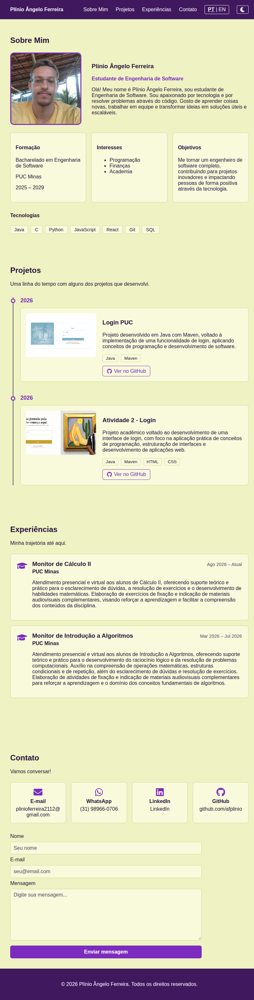
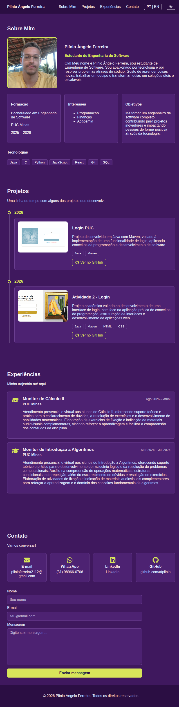

# 💼 Portfólio Profissional 👨‍💻

> Website de portfólio profissional para apresentar minha trajetória, habilidades, projetos e formas de contato de maneira moderna, responsiva e acessível, em português e inglês.

Projeto desenvolvido no **Laboratório 01** da disciplina de Desenvolvimento e Integração de Aplicações Web (DIAW) — Engenharia de Software, PUC Minas.

🌐 **Acesse o site:** https://plinioferreira.vercel.app/

---

## 🚧 Status do Projeto


- ✅ **Sprint 1:** planejamento e prototipação (README, wireframes, navegação e layout principal)
- ✅ **Sprint 2:** funcionalidades principais (Sobre Mim PT/EN, timeline de projetos, experiências, contato)
- ✅ **Sprint 3:** hospedagem na Vercel, ajustes visuais e de usabilidade, README final

---

## 📚 Índice

- [Links Úteis](#-links-úteis)
- [Sobre o Projeto](#-sobre-o-projeto)
- [Funcionalidades Principais](#-funcionalidades-principais)
- [Tecnologias Utilizadas](#-tecnologias-utilizadas)
- [Arquitetura](#-arquitetura)
- [Identidade Visual](#-identidade-visual)
- [Instalação e Execução](#-instalação-e-execução)
- [Deploy](#-deploy)
- [Estrutura de Pastas](#-estrutura-de-pastas)
- [Demonstração](#-demonstração)
- [Documentações utilizadas](#-documentações-utilizadas)
- [Autores](#-autores)
- [Agradecimentos](#-agradecimentos)
- [Licença](#-licença)

---

## 🔗 Links Úteis

- 🌐 **Site publicado:** https://plinioferreira.vercel.app/
- 🎨 **Protótipos no Figma:** https://www.figma.com/design/tmhxeLKnrAbgAoPKgntWlk/DIAW-LAB-01-Wireframes-portf%C3%B3lio?node-id=0-1&t=ACAXw8kpFpUc8cZd-1
- 💻 **Repositório:** https://github.com/afplinio/portfolio

---

## 📝 Sobre o Projeto

Este projeto é o meu portfólio profissional, criado para reunir em um só lugar quem eu sou, o que já desenvolvi e como entrar em contato comigo. Ele nasceu como atividade acadêmica, mas foi pensado para ser usado de verdade: apresentar minha trajetória a recrutadores, professores e colegas da área.

O site é dividido em quatro seções, acessadas por um menu de navegação:

- **Sobre Mim:** apresentação em português e inglês, com formação, interesses, objetivos e tecnologias.
- **Projetos:** linha do tempo com nome, descrição, tecnologias, link do repositório no GitHub e imagem de cada projeto.
- **Experiências:** monitorias, com instituição, cargo, período e descrição.
- **Contato:** ícones clicáveis (e-mail, WhatsApp, LinkedIn e GitHub) e formulário com envio de mensagem por e-mail.

---

## ✨ Funcionalidades Principais

- 🧭 **Navegação por seções:** menu fixo no topo, com rolagem suave até cada seção.
- 🌐 **Internacionalização (i18n):** alternância de idioma PT | EN, incluindo o idioma declarado da página.
- 🌗 **Tema claro/escuro:** respeita o tema do sistema na primeira visita e lembra a escolha do visitante.
- 🕒 **Timeline de projetos:** ordenada automaticamente, do mais antigo ao mais recente.
- 💼 **Experiências organizadas:** ordenadas da mais recente para a mais antiga.
- 📨 **Formulário de contato:** validações (nome, e-mail e mensagem) e envio por e-mail via EmailJS, com mensagens de sucesso e erro.
- 📱 **Design responsivo:** layout adaptado para desktop e celular.
- ♿ **Acessibilidade básica:** foco visível na navegação por teclado, contraste de cores verificado e respeito à preferência de movimento reduzido.

---

## 🛠 Tecnologias Utilizadas

### 💻 Front-end

- **Biblioteca:** React (19.3.0)
- **Linguagem:** JavaScript (ES6+)
- **Build Tool:** Vite (8.3.0)
- **Estilização:** CSS puro, com variáveis CSS para os temas
- **Ícones:** React Icons
- **Qualidade de código:** ESLint

### 🔌 Integrações

- **EmailJS:** envio de e-mail diretamente do front-end, usado no formulário de contato.

### ⚙️ Infraestrutura & Ferramentas

- **Hospedagem:** Vercel
- **Versionamento:** Git e GitHub
- **Protótipos:** Figma

### 📦 Dependências e bibliotecas

| Pacote | Versão | Uso |
| --- | --- | --- |
| `react` | (19.3.0) | Biblioteca de interface |
| `react-dom` | (19.3.0) | Renderização do React no navegador |
| `react-icons` | (5.7.0) | Ícones (contato, GitHub, tema, experiências) |
| `@emailjs/browser` | (5.0.3) | Envio de e-mail pelo formulário |

**Desenvolvimento:** Vite, plugin do React para o Vite, ESLint e plugins de React (lista completa e versões no `package.json`).

---

## 🏗 Arquitetura

O projeto é uma **aplicação front-end de página única (SPA)**, sem back-end próprio. O conteúdo é renderizado no navegador pelo React, organizado em **componentes reutilizáveis**: um para o cabeçalho, um para o rodapé e um para cada seção.

- **Separação entre dados e interface:** textos, projetos, experiências e tecnologias ficam em arquivos de dados (`src/data`). Os componentes só exibem esses dados, então adicionar um projeto ou uma experiência é editar um arquivo, sem mexer na interface.
- **Estado no `App`:** o idioma e o tema ficam no componente principal e são repassados aos filhos por *props*.
- **Tema:** definido por variáveis CSS trocadas por um atributo `data-theme` na página. A escolha fica salva no navegador (`localStorage`) e um pequeno script no `index.html` aplica o tema antes da página aparecer, evitando "piscar".
- **Envio de e-mail:** feito pelo serviço EmailJS, sem servidor próprio. As chaves ficam em variáveis de ambiente.
- **Hospedagem:** o build estático gerado pelo Vite é publicado na Vercel, com deploy automático a cada `push` na branch `main`.

---

## 🎨 Identidade Visual

A paleta parte de duas cores de fundo, e **cada tema usa a cor do outro como destaque**, o que mantém a coerência entre os dois.

| Papel | Tema claro | Tema escuro |
| --- | --- | --- |
| Fundo | `#EFF2C2` | `#3F185E` |
| Cartões | `#F8FADB` | `#4D2272` |
| Texto | `#2A1240` | `#F3EEF8` |
| Destaque | `#7B2CBF` | `#D7E55A` |

---

## 🔧 Instalação e Execução

### Pré-requisitos

- **Node.js:** versão LTS (v18 ou superior)
- **Gerenciador de pacotes:** npm
- **Git**

### 📦 Instalação de Dependências

```bash
git clone https://github.com/afplinio/portfolio.git
cd portfolio
npm install
```

### 🔑 Variáveis de Ambiente

O formulário de contato usa o EmailJS. Copie o arquivo de exemplo e preencha com as suas chaves:

```bash
cp .env.example .env.local
```

| Variável | Descrição |
| --- | --- |
| `VITE_EMAILJS_SERVICE_ID` | ID do serviço configurado no EmailJS |
| `VITE_EMAILJS_TEMPLATE_ID` | ID do template de e-mail |
| `VITE_EMAILJS_PUBLIC_KEY` | Chave pública do EmailJS |

> O arquivo `.env.local` não é versionado. Sem as chaves, o site funciona normalmente, exceto o envio real do formulário.

### ⚡ Como Executar a Aplicação

```bash
npm run dev
```

O site ficará disponível em **http://localhost:5173**.

### 🏁 Build de produção

```bash
npm run build
npm run preview
```

---

## 🚀 Deploy

O site está publicado na **Vercel**, conectada ao repositório do GitHub: https://plinioferreira.vercel.app/

Cada `git push` na branch `main` gera um novo deploy automaticamente.

Para publicar uma cópia própria:

1. Importar o repositório na Vercel (o framework Vite é detectado automaticamente).
2. Configurar as três variáveis de ambiente do EmailJS (`VITE_EMAILJS_*`) antes do primeiro deploy.
3. Clicar em **Deploy**.

---

## 📂 Estrutura de Pastas

```
.
├── docs/
│   ├── wireframes/              # 🎨 Protótipos (média fidelidade)
│   └── screenshots/             # 📸 Prints do site publicado
├── public/
│   ├── projetos/                # 🖼️ Imagens dos projetos
│   └── favicon.svg              # 🔖 Ícone da aba
├── src/
│   ├── assets/                  # 🖼️ Foto de perfil
│   ├── components/              # 🧱 Componentes e seus estilos
│   │   ├── Header.jsx
│   │   ├── Sobre.jsx
│   │   ├── Projetos.jsx
│   │   ├── Experiencias.jsx
│   │   ├── Contato.jsx
│   │   └── Footer.jsx
│   ├── data/                    # 🗂️ Conteúdo separado da interface
│   │   ├── translations.js      # Textos em PT e EN
│   │   ├── projetos.js
│   │   ├── experiencias.js
│   │   └── tecnologias.js
│   ├── App.jsx                  # 🧩 Componente principal (idioma e tema)
│   ├── main.jsx                 # 🚪 Ponto de entrada
│   └── index.css                # 🎨 Variáveis de tema e estilos globais
├── .env.example                 # 🔑 Modelo das variáveis de ambiente
├── index.html                   # 📄 HTML base
├── package.json                 # 📦 Dependências e scripts
├── eslint.config.js             # ✨ Regras do ESLint
├── vite.config.js               # ⚙️ Configuração do Vite
└── README.md                    # 📘 Documentação do projeto
```

---

## 🎥 Demonstração

### 🎨 Protótipos (wireframes de média fidelidade)


### 🌐 Aplicação Web

**Desktop — tema claro**



**Desktop — tema escuro**



**Celular**


---

## 🔗 Documentações utilizadas

- 📖 [React](https://react.dev/)
- 📖 [Vite](https://vite.dev/)
- 📖 [React Icons](https://react-icons.github.io/react-icons/)
- 📖 [EmailJS](https://www.emailjs.com/docs/)
- 📖 [Vercel](https://vercel.com/docs)
- 📖 [Figma](https://help.figma.com/)

---

## 👥 Autores

| 👤 Nome | GitHub |
| --- | --- |
| Plínio Ângelo Ferreira | [@afplinio](https://github.com/afplinio) |

---

## 🙏 Agradecimentos

- [**Engenharia de Software PUC Minas**](https://www.instagram.com/engsoftwarepucminas/) — pelo apoio institucional e estrutura acadêmica.
- [**Prof. Dr. João Paulo Aramuni**](https://github.com/joaopauloaramuni) — pela orientação na disciplina e pelo template de README.
- **Gabriel Victor** — pelo portfólio que serviu de inspiração para a estrutura do site.

---

## 📄 Licença

Projeto acadêmico, de uso educacional.