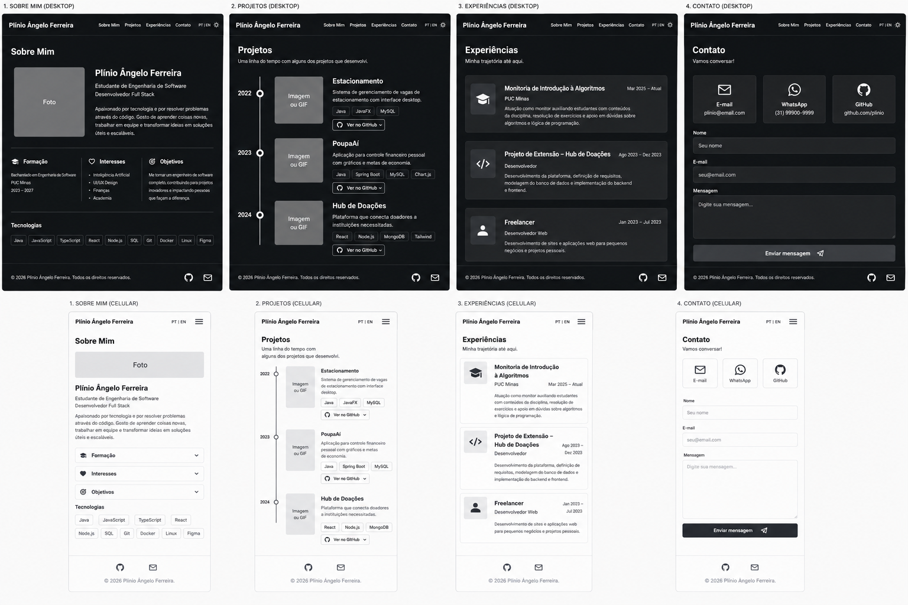

# 💼 Portfólio Profissional 👨‍💻

> Website de portfólio profissional para apresentar minha trajetória, habilidades, projetos e formas de contato de maneira moderna, responsiva e acessível, em português e inglês.

Projeto desenvolvido no **Laboratório 01** da disciplina de Desenvolvimento e Integração de Aplicações Web (DIAW) — Engenharia de Software, PUC Minas.

---

## 🚧 Status do Projeto


- ✅ **Sprint 1:** planejamento e prototipação (README, wireframes, navegação e layout principal)
- ⏳ **Sprint 2:** funcionalidades principais (Sobre Mim PT/EN, timeline de projetos, experiências, contato)
- ⏳ **Sprint 3:** deploy na Vercel e finalização

---

## 📚 Índice

- [Links Úteis](#-links-úteis)
- [Sobre o Projeto](#-sobre-o-projeto)
- [Funcionalidades Principais](#-funcionalidades-principais)
- [Tecnologias Utilizadas](#-tecnologias-utilizadas)
- [Arquitetura](#-arquitetura)
- [Instalação e Execução](#-instalação-e-execução)
- [Deploy](#-deploy)
- [Estrutura de Pastas](#-estrutura-de-pastas)
- [Demonstração](#-demonstração)
- [Documentações utilizadas](#-documentações-utilizadas)
- [Autores](#-autores)
- [Agradecimentos](#-agradecimentos)
- [Licença](#-licença)

---

## 🔗 Links Úteis

- 🌐 **Site publicado:** _será adicionado após o deploy na Vercel (Sprint 3)_
- 🎨 **Protótipos no Figma:** https://www.figma.com/design/tmhxeLKnrAbgAoPKgntWlk/DIAW-LAB-01-Wireframes-portf%C3%B3lio?node-id=0-1&t=ACAXw8kpFpUc8cZd-1
- 💻 **Repositório:** https://github.com/afplinio/portfolio

---

## 📝 Sobre o Projeto

Este projeto é o meu portfólio profissional, criado para reunir em um só lugar quem eu sou, o que já desenvolvi e como entrar em contato comigo. Ele nasceu como atividade acadêmica, mas foi pensado para ser usado de verdade: apresentar minha trajetória a recrutadores, professores e colegas da área.

O site é dividido em quatro seções, acessadas por um menu de navegação:

- **Sobre Mim:** apresentação em português e inglês, com formação, área de atuação, interesses e objetivos profissionais.
- **Projetos:** linha do tempo, do mais antigo ao mais recente, com nome, descrição, tecnologias, link do repositório no GitHub e imagem/GIF do projeto em funcionamento.
- **Experiências:** monitorias, projetos de extensão e eventos, com instituição, cargo/atividade, período e breve descrição.
- **Contato:** ícones clicáveis (e-mail, WhatsApp, GitHub) e formulário com envio de mensagem por e-mail.

---

## ✨ Funcionalidades Principais

- 🧭 **Navegação por seções:** menu fixo no topo que leva a cada seção.
- 🌐 **Internacionalização (i18n):** alternância de idioma PT | EN.
- 🌗 **Tema claro/escuro:** alternância de tema pelo cabeçalho.
- 🕒 **Timeline de projetos:** apresentação cronológica com imagem/GIF, tecnologias e link do GitHub.
- 💼 **Experiências organizadas:** dados estruturados em cartões.
- 📨 **Formulário de contato:** com validações básicas e envio por e-mail.
- 📱 **Design responsivo:** layout adaptado para desktop e celular.

---

## 🛠 Tecnologias Utilizadas

### 💻 Front-end

- **Biblioteca:** React (19.2.8)
- **Linguagem:** JavaScript (ES6+)
- **Build Tool:** Vite (8.3.0)
- **Estilização:** CSS
- **Qualidade de código:** ESLint

### 🔌 Integrações (previstas)

- **EmailJS:** envio de e-mail diretamente do front-end, usado no formulário de contato.

### ⚙️ Infraestrutura & Ferramentas

- **Hospedagem:** Vercel
- **Versionamento:** Git e GitHub
- **Protótipos:** Figma

---

## 🏗 Arquitetura

O projeto é uma **aplicação front-end de página única (SPA)**, sem back-end próprio. O conteúdo é renderizado no navegador pelo React, organizado em **componentes reutilizáveis** (cabeçalho, rodapé e uma seção para cada área do site).

- **Componentes:** cada parte da interface fica em um arquivo próprio dentro de `src/components`.
- **Dados:** textos, projetos e experiências ficarão separados do código visual, para facilitar manutenção e a troca de idioma.
- **Envio de e-mail:** feito pelo serviço EmailJS, sem necessidade de servidor próprio.
- **Hospedagem:** o build estático gerado pelo Vite é publicado na Vercel.

---

## 🔧 Instalação e Execução

### Pré-requisitos

- **Node.js:** versão LTS (v18 ou superior)
- **Gerenciador de pacotes:** npm
- **Git**

### 🔑 Variáveis de Ambiente (previstas para o formulário de contato)

Crie um arquivo `.env.local` na raiz do projeto. As variáveis do Vite precisam do prefixo `VITE_`.

| Variável | Descrição |
| --- | --- |
| `VITE_EMAILJS_SERVICE_ID` | ID do serviço configurado no EmailJS |
| `VITE_EMAILJS_TEMPLATE_ID` | ID do template de e-mail |
| `VITE_EMAILJS_PUBLIC_KEY` | Chave pública do EmailJS |

> Este arquivo não é versionado (está no `.gitignore`).

### 📦 Instalação de Dependências

```bash
git clone https://github.com/afplinio/portfolio.git
cd portfolio
npm install
```

### ⚡ Como Executar a Aplicação

```bash
npm run dev
```

O site ficará disponível em **http://localhost:5173**.

---

## 🚀 Deploy

O deploy será feito na **Vercel**, conectada ao repositório do GitHub.

1. **Gerar o build de produção:**

```bash
npm run build
```

2. Importar o repositório na Vercel (framework detectado automaticamente: Vite).
3. Configurar as variáveis de ambiente do EmailJS no painel da Vercel.
4. A cada `git push` na branch `main`, um novo deploy é gerado automaticamente.

---

## 📂 Estrutura de Pastas

```
.
├── docs/
│   └── wireframes/          # 🎨 Imagens dos protótipos
├── public/                  # 📂 Arquivos estáticos
├── src/
│   ├── components/          # 🧱 Componentes (Header, Footer, seções...)
│   ├── App.jsx              # 🧩 Componente principal
│   ├── main.jsx             # 🚪 Ponto de entrada da aplicação
│   └── index.css            # 🎨 Estilos globais
├── index.html               # 📄 HTML base
├── package.json             # 📦 Dependências e scripts
├── eslint.config.js         # ✨ Regras do ESLint
├── vite.config.js           # ⚙️ Configuração do Vite
└── README.md                # 📘 Documentação do projeto
```

> A estrutura evolui nas próximas sprints (pasta de dados, imagens dos projetos, traduções).

---

## 🎥 Demonstração

### 🎨 Protótipos (wireframes de média fidelidade)



### 🌐 Aplicação Web

_Prints e GIFs do site em funcionamento serão adicionados na Sprint 3._

---

## 🔗 Documentações utilizadas

- 📖 [React](https://react.dev/)
- 📖 [Vite](https://vite.dev/)
- 📖 [EmailJS](https://www.emailjs.com/docs/)
- 📖 [Vercel](https://vercel.com/docs)
- 📖 [Figma](https://help.figma.com/)

---

## 👥 Autores

| 👤 Nome | GitHub |
| --- | --- |
| Plínio Ângelo Ferreira | [@afplinio](https://github.com/afplinio) |

---

## 🙏 Agradecimentos

- [**Engenharia de Software PUC Minas**](https://www.instagram.com/engsoftwarepucminas/) — pelo apoio institucional e estrutura acadêmica.
- [**Prof. Dr. João Paulo Aramuni**](https://github.com/joaopauloaramuni) — pela orientação na disciplina e pelo template de README.
- **Gabriel Victor** — pelo portfólio que serviu de inspiração para a estrutura do site.

---

## 📄 Licença

Projeto acadêmico, de uso educacional.